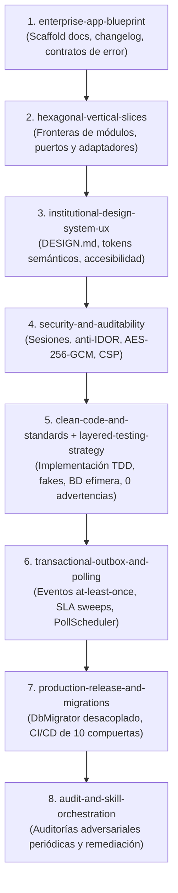

# Enterprise Engineering Kit (`enterprise-engineering-kit`)

[](https://github.com/agent-skills/spec)
[](#instalaci%C3%B3n-y-compatibilidad-multi-agente)
[](#2-hexagonal-vertical-slices)
[-F59E0B?style=flat-square)](#guardrails-ejecutables-y-herramientas-ci)
[](#6-institutional-design-system-ux)
[](#4-layered-testing-strategy)

Colección modular de **9 skills estandarizadas de ingeniería de software** diseñadas para guiar a asistentes de inteligencia artificial (Google Antigravity, Anthropic Claude Code, OpenAI Codex, Cursor, Windsurf) y equipos humanos en la creación, refactorización y auditoría de **aplicaciones empresariales e institucionales de misión crítica**.

El kit es **100 % agnóstico de lenguaje y framework** (compatible con TypeScript/JavaScript, C#, Python, Go, Java/Kotlin, Rust, etc.) y opera bajo el principio de **divulgación progresiva (*Progressive Disclosure*)**, optimizando el uso de la ventana de contexto del agente mediante instrucciones ejecutables, manuales de referencia profunda, plantillas de inicio y **guardrails automatizados sin dependencias externas**.

---

## Tabla de Contenidos

1. [Propuesta de Valor e Invariantes Fundacionales](#propuesta-de-valor-e-invariantes-fundacionales)
2. [Anatomía de una Skill (Estándar de la Industria)](#anatom%C3%ADa-de-una-skill-est%C3%A1ndar-de-la-industria)
3. [Catálogo Completo de Skills](#cat%C3%A1logo-completo-de-skills)
   - [1. `enterprise-app-blueprint`](#1-enterprise-app-blueprint)
   - [2. `hexagonal-vertical-slices`](#2-hexagonal-vertical-slices)
   - [3. `clean-code-and-standards`](#3-clean-code-and-standards)
   - [4. `layered-testing-strategy`](#4-layered-testing-strategy)
   - [5. `transactional-outbox-and-polling`](#5-transactional-outbox-and-polling)
   - [6. `institutional-design-system-ux`](#6-institutional-design-system-ux)
   - [7. `security-and-auditability`](#7-security-and-auditability)
   - [8. `production-release-and-migrations`](#8-production-release-and-migrations)
   - [9. `audit-and-skill-orchestration`](#9-audit-and-skill-orchestration)
4. [Flujo Recomendado de Adopción (Ciclo de Vida)](#flujo-recomendado-de-adopci%C3%B3n-ciclo-de-vida)
5. [Guardrails Ejecutables y Herramientas CI/CD](#guardrails-ejecutables-y-herramientas-cicd)
6. [Instalación y Compatibilidad Multi-Agente](#instalaci%C3%B3n-y-compatibilidad-multi-agente)
7. [Estructura del Repositorio](#estructura-del-repositorio)
8. [Gobernanza y Contribución](#gobernanza-y-contribuci%C3%B3n)

---

## Propuesta de Valor e Invariantes Fundacionales

La mayoría de los kits de instrucciones para IA se limitan a listas pasivas de consejos (*prompts*) que se degradan con el tiempo o generan código desordenado. Este kit implementa el estándar riguroso de ingeniería de grado institucional:

* **100 % Agnóstico e Independiente**: Los patrones arquitectónicos, las reglas de concurrencia, las políticas de seguridad y la higiene se aplican con igual rigor en una API en ASP.NET Core / C#, servicios en Go, microservicios en Python o aplicaciones web en Next.js / Vue / Angular.
* **Ley Cero de Integridad de Pruebas (*Anti-Tampering Law*)**: Queda terminantemente prohibido modificar, relajar o silenciar (`skip`) una prueba que falla solo para conseguir un pipeline en verde. Todo fallo se asume como indicio de un defecto real en el código de producción.
* **Guardrails Automatizados sin Dependencias**: Incluye 5 scripts en Node.js puro (`.mjs`, Node >= 18) con cero dependencias en `npm`, listos para incorporarse como compuertas obligatorias de pre-commit y CI/CD.
* **Optimización de Contexto (*Progressive Disclosure*)**: Los agentes solo cargan en memoria el nombre y activadores de la skill. El archivo `SKILL.md` se lee únicamente bajo demanda, y las referencias profundas (`references/`) se consultan solo cuando la tarea técnica específica lo exige.
* **Gobernanza Documental Estricta**: Modelo de entrada breve (`AGENTS.md`) con derivación a 10 subcarpetas canónicas en `docs/` y bitácora inmutable (`docs/historial/changelog.md`) con entradas congeladas correlativas `### AAAA-MM-DD (N)`.

---

## Anatomía de una Skill (Estándar de la Industria)

Cada skill del kit sigue estrictamente la arquitectura modular adoptada por los ecosistemas de agentes más avanzados:

```text
skills/<skill-name>/
├── SKILL.md                 # Punto de entrada con frontmatter YAML (name, description, activators)
├── agents/
│   └── openai.yaml          # Metadatos universales para agentes tipo Codex / OpenAI
├── references/              # Documentación técnica profunda, contratos y runbooks operativos
│   └── *.md
├── resources/               # Plantillas listas para andamiaje (.template.md, configs de ejemplo)
│   └── *.template.*
└── scripts/                 # Validadores ejecutables sin dependencias externas (Node >= 18)
    └── *.mjs
```

### Contrato de Frontmatter en `SKILL.md`

```yaml
---
name: nombre-de-la-skill
description: >-
  Descripción concisa del problema que resuelve, cuándo debe utilizarse y los
  activadores (palabras clave en lenguaje natural) que despiertan su carga.
---
```

---

## Catálogo Completo de Skills

| # | Skill | Responsabilidad Principal | Activadores Clave | Artefactos Incluidos |
|---|---|---|---|---|
| 1 | [`enterprise-app-blueprint`](#1-enterprise-app-blueprint) | Estructura base de repositorio, gobernanza documental, contrato universal de errores, concurrencia optimista y paginación. | `nuevo proyecto`, `blueprint`, `AGENTS.md`, `contrato de errores`, `concurrencia` | Scripts: `scaffold-project-docs`, `check-docs-governance` + 5 plantillas |
| 2 | [`hexagonal-vertical-slices`](#2-hexagonal-vertical-slices) | Arquitectura Hexagonal simétrica + Vertical Slicing backend/frontend, raíces de composición y decoradores. | `arquitectura hexagonal`, `vertical slicing`, `ports and adapters`, `boundaries` | Script: `check-architecture-boundaries` + `boundaries.config.example.json` |
| 3 | [`clean-code-and-standards`](#3-clean-code-and-standards) | Política de cero advertencias, higiene de comentarios, cero código muerto, reloj determinista y consultas acotadas. | `clean code`, `revisión de código`, `código muerto`, `zero warnings` | Script: `audit-code-hygiene` + 2 guías de referencia |
| 4 | [`layered-testing-strategy`](#4-layered-testing-strategy) | Ley Cero Anti-Tampering, pirámide de pruebas honesta (fakes manuales, fixtures completas, BD efímera, E2E). | `tests`, `testing`, `pruebas unitarias`, `fakes`, `disposable database` | Manual: `test-integrity-and-triage` + guías de fakes/fixtures |
| 5 | [`transactional-outbox-and-polling`](#5-transactional-outbox-and-polling) | Efectos secundarios durables (*at-least-once*), Outbox con leases, jobs de barrido SLA y sondeo disciplinado (`PollScheduler`). | `outbox`, `eventos durables`, `background jobs`, `SLA sweep`, `polling` | Especificaciones de Outbox, leases SQL y `PollScheduler` |
| 6 | [`institutional-design-system-ux`](#6-institutional-design-system-ux) | Tokens semánticos de 2 niveles, interfaces operativas densas, accesibilidad WCAG 2.1 AA e i18n tipada por scopes. | `sistema de diseño`, `tokens`, `WCAG`, `accesibilidad`, `vistas operativas`, `i18n` | Script: `check-design-system` + `DESIGN.template.md`, `tokens.template.css` |
| 7 | [`security-and-auditability`](#7-security-and-auditability) | Sesiones revocables, permisos en BD anti-IDOR, cifrado documental AES-256-GCM con AAD, CSP estricto y redacción de PII. | `seguridad`, `autenticación`, `IDOR`, `cifrado`, `CSP`, `logs estructurados` | Especificación criptográfica, matrices IDOR y redacción de logs |
| 8 | [`production-release-and-migrations`](#8-production-release-and-migrations) | `DbMigrator` CLI desacoplado de la API (3 identidades SQL), pipelines CI/CD de 10 compuertas y checklists post-deploy. | `despliegue`, `CI/CD`, `migraciones`, `DbMigrator`, `health checks`, `producción` | Protocolo `DbMigrator`, checklist de despliegue y compuertas CI |
| 9 | [`audit-and-skill-orchestration`](#9-audit-and-skill-orchestration) | Coordinación sin solapamientos con skills de auditoría de seguridad (`security-audit`), consistencia UX y entrevista previa. | `auditoría`, `security audit`, `revisión UI/UX`, `orquestación`, `grill me` | Matriz de sinergia entre skills y flujos de remediación |

---

### Detalle de Capacidades por Skill

#### 1. `enterprise-app-blueprint`
Establece los cimientos estructurales y normativos para que una aplicación crezca sin deriva técnica:
* **Entrada documental controlada**: Mantiene `AGENTS.md` como índice ejecutivo breve (< 160 líneas), canalizando todo detalle normativo a las 10 subcarpetas de `docs/` (`arquitectura/`, `requisitos/`, `guias/`, `operacion/`, `decisiones/`, `auditorias/`, `planes/`, `reglas/`, `estandares/`, `historial/`).
* **Bitácora Inmutable**: Impone `docs/historial/changelog.md` con formato estricto `### AAAA-MM-DD (N)` donde cada registro documenta honestamente alcance, decisiones y verificación.
* **Contrato Universal de Errores e i18n**: Respuestas controladas `{ reason: "STABLE_CODE", details? }` listas para traducción en cliente. Las excepciones internas (500) ocultan detalles y retornan un `traceId` único correlacionado con logs del servidor.
* **Concurrencia Optimista por Defecto**: Actualizaciones condicionadas a token de versión (`rowVersion`, `version` o `ETag`), respondiendo `412 Precondition Failed` ante colisiones.
* **Paginación en Servidor y Baja Lógica**: Prohibición de endpoints que devuelvan colecciones no acotadas a memoria; baja lógica (`isActive = false`) y auditoría transversal en entidades operativas.

#### 2. `hexagonal-vertical-slices`
Resuelve la organización del código respondiendo simultáneamente a dos preguntas:
* **Dirección de Dependencias (Hexagonal)**: El Dominio (`domain`) no depende de nada externo; la Aplicación (`application`) orquesta casos de uso y define puertos; la Infraestructura (`infrastructure`) implementa los adaptadores; la Presentación (`ui` / `api`) solo consume puertos de entrada.
* **Propiedad de Negocio (Vertical Slices)**: Cada funcionalidad (`features/<nombre-feature>/`) encapsula sus casos de uso, contratos y adaptadores, erradicando carpetas horizontales genéricas y desordenadas.
* **Composición Limpia**: Inyección y puenteo exclusivamente mediante raíces de composición por alcance (`composition/`), permitiendo decorar puertos con caché o métricas sin contaminar la lógica de negocio.

#### 3. `clean-code-and-standards`
Garantiza precisión y mantenibilidad con reglas no negociables:
* **0 Advertencias**: Configuración de compiladores y analizadores con tratamiento de advertencias como errores (`treat warnings as errors`).
* **Higiene Quirúrgica de Comentarios**: Prohibición de narrativa histórica ("corregido según auditoría", "a pedido del usuario") o paráfrasis obvia. Los comentarios explican exclusivamente invariantes técnicas no obvias o limitaciones de integraciones externas.
* **Reloj Inyectado**: Prohibición del uso estático o directo del reloj del sistema (`DateTime.UtcNow`, `new Date()`, `time.Now()`) en dominios o casos de uso; siempre se inyecta un proveedor de tiempo abstracto para garantizar pruebas deterministas.
* **Rendimiento de Consultas**: Lecturas optimizadas sin seguimiento de cambios (`AsNoTracking`, proyecciones directas DTO), límites estrictos en lotes y presupuesto de memoria.

#### 4. `layered-testing-strategy`
Implementa una suite de pruebas predecible y honesta:
* **Ley Cero Anti-Tampering**: Si un test falla, la presunción absoluta es que existe un defecto real en el código de producción. Queda prohibido modificar la prueba, cambiar sus aserciones o marcarla como `skip` para forzar el verde en CI.
* **Pirámide por Responsabilidad**:
  * *Dominio*: Pruebas unitarias puras y ultrarrápidas sin dobles de prueba.
  * *Casos de Uso*: Pruebas con fakes explícitos en memoria (escritos a mano con interfaces limpias), evitando librerías de mocking acopladas a la implementación interna.
  * *Componentes / UI*: Fixtures completas e inyección del motor real de traducciones (i18n), verificando accesibilidad e interactividad.
  * *Integración*: Ejecución contra instancias reales y efímeras de base de datos (descartables por suite), con limpieza transaccional obligatoria.
  * *E2E*: Flujos críticos completos de usuario en navegador real con aislamiento y datos de prueba autolimpiables.

#### 5. `transactional-outbox-and-polling`
Manejo disciplinado de la asincronía y el tiempo real sin introducir complejidad innecesaria:
* **Outbox Transaccional**: Registro atómico de eventos y efectos secundarios (envío de correos, generación de PDFs, webhooks) dentro de la misma transacción de base de datos del negocio.
* **Workers con Leases y Heartbeat**: Despachadores en segundo plano con bloqueo optimista/leasings para garantizar entrega *at-least-once* y evitar procesamiento concurrente duplicado.
* **Barrido de Plazos (SLA Sweeper)**: Procesos periódicos de base de datos para vigilar vencimientos, estados estancados o alertas preventivas sin intervención del usuario.
* **`PollScheduler` en Cliente**: Mecanismo de sondeo periódico disciplinado con retroceso exponencial, pausa cuando la pestaña está en segundo plano y detección de cambios de red, ideal para entornos con proxies institucionales donde SSE o WebSockets son inestables.

#### 6. `institutional-design-system-ux`
Diseño de software empresarial centrado en la usabilidad y la accesibilidad:
* **Sistema de Tokens de Dos Niveles**:
  1. *Tokens Primitivos / Globales*: Paleta cruda (`--brand-blue-500`, `--neutral-100`).
  2. *Tokens Semánticos de Decisión*: Propósito contextual explícito (`--color-surface-card`, `--color-border-interactive`, `--text-danger`). El código de producción consume **únicamente tokens semánticos**.
* **Patrones Operativos Densos**: Vistas de expedientes, asistentes (*wizards*) multi-etapa con preservación de estado, tablas con transformación automática a tarjetas móviles, modales con confirmación segura y líneas de tiempo auditables.
* **Accesibilidad WCAG 2.1 AA**: Paridad de foco obligatoria (`:focus-visible` explícito; prohibido `outline: none` sin reemplazo visible), ratios de contraste certificados y navegación íntegra por teclado.
* **Internacionalización Robusta**: Cero cadenas de texto literales en plantillas HTML/JSX. Soporte de namespaces de traducción con validación estática.

#### 7. `security-and-auditability`
Seguridad defensiva en profundidad desde las bases del código:
* **Sesiones Revocables con Sello de Versión**: Cada solicitud valida el `security_version` del usuario en sesión/base de datos, permitiendo invalidación instantánea ante cambio de credenciales o cierre forzado.
* **Autorización en Base de Datos y Alcance Anti-IDOR**: Las consultas y mutaciones filtran obligatoriamente por la organización o tenencia del usuario (`tenantId`, `organizationId`) en la consulta SQL/ORM, impidiendo la manipulación de identificadores en la URL.
* **Cifrado Documental en Repositorio**: Cifrado de documentos confidenciales mediante `AES-256-GCM` con Datos Asociados Autenticados (`AAD`), vinculando criptográficamente el archivo a la entidad que lo posee.
* **Cabeceras de Endurecimiento**: CSP estricto con `nonces` o hashes, Trusted Types para neutralizar inyecciones DOM-XSS, cookies seguras `SameSite=Strict` y protección anti-CSRF por token sincronizado.
* **Bitácora Estructurada sin Fugas de Información**: Formato JSON estructurado con correlación mediante `traceId` y redacción automática obligatoria de contraseñas, tokens y datos sensibles (PII).

#### 8. `production-release-and-migrations`
Entrega confiable y reproducible en servidores empresariales:
* **Separación de Privilegios y Desacoplamiento del Runtime**: La API de producción **nunca ejecuta DDL ni crea usuarios privilegiados al iniciar**. Las migraciones se gestionan mediante una herramienta CLI independiente (`DbMigrator`) ejecutada exclusivamente en la fase de despliegue.
* **Triple Identidad de Base de Datos**:
  1. *Identidad de Migración*: Permisos DDL transitorios para la ejecución del `DbMigrator`.
  2. *Identidad de Aplicación (Runtime)*: Permisos mínimos de lectura/escritura (`SELECT`, `INSERT`, `UPDATE`, `DELETE`) sin privilegios de modificación de esquema.
  3. *Identidad de Soporte/Auditoría*: Solo lectura (`SELECT`) sin acceso a tablas de secretos.
* **Manifiesto SQL con Integridad SHA-256**: Los scripts de migración son auditables, idempotentes y verificados mediante hash criptográfico para evitar alteraciones post-revisión.
* **Compuertas de Calidad CI/CD**: Pipeline de 10 etapas automatizadas antes de autorizar el paso a producción.

#### 9. `audit-and-skill-orchestration`
Establece la coordinación armónica y sin conflictos entre las skills del kit y herramientas externas especializadas:
* **Auditoría de Seguridad Adversarial**: Este kit define los controles constructivos; la auditoría ofensiva y de penetración delega en `security-audit` (modo solo lectura, clasificación `confirmed` / `needs_validation` y artefactos fuera del repo).
* **Consistencia Visual y Ergonomía UI**: Coordina con `design-consistency-auditor`, `ui-ux-pro-max` e `impeccable` respetando la jerarquía donde el archivo `DESIGN.md` del proyecto es la autoridad suprema.
* **Interrogatorio de Diseño y Documentación Viva**: Integración fluida con `grilling` para resolver decisiones críticas antes de codificar y con `context7-mcp` para verificar firmas exactas de versiones instaladas de librerías.

---

## Flujo Recomendado de Adopción (Ciclo de Vida)



---

## Guardrails Ejecutables y Herramientas CI/CD

El kit provee **5 herramientas automáticas de validación** desarrolladas en Node.js puro (`.mjs`, compatible con Node >= 18) con **cero dependencias externas** (no requieren `npm install`). Pueden ejecutarse localmente o incorporarse a cualquier pipeline de integración continua.

### 1. `scaffold-project-docs.mjs`
Inicializa el gobierno documental del proyecto generando `AGENTS.md`, `DESIGN.md`, `.editorconfig`, `.gitignore` y las 10 subcarpetas de `docs/` con su primera entrada en `changelog.md`:
```bash
node skills/enterprise-app-blueprint/scripts/scaffold-project-docs.mjs --target . --name "NombreProyecto" [--force]
```

### 2. `check-docs-governance.mjs`
Verifica que `AGENTS.md` permanezca conciso (< 160 líneas), que no existan archivos Markdown sueltos en la raíz de `docs/`, que la secuencia del `changelog.md` sea correlativa y que no haya enlaces relativos rotos:
```bash
node skills/enterprise-app-blueprint/scripts/check-docs-governance.mjs --root . [--max-agents-lines 160]
```

### 3. `check-architecture-boundaries.mjs`
Validador agnóstico de fronteras arquitectónicas (Hexagonal + Vertical Slices). Verifica que el dominio no importe capas externas y que no haya dependencias cruzadas indebidas entre features:
```bash
node skills/hexagonal-vertical-slices/scripts/check-architecture-boundaries.mjs --config ./boundaries.config.json [--root .]
```
*Soporta análisis estático de código en:* TypeScript, JavaScript, Python, Go, C#, Java, Kotlin y Rust.

### 4. `audit-code-hygiene.mjs`
Audita la base de código detectando narrativa conversacional en comentarios, supresiones evasivas sin justificar, uso directo de relojes del sistema y pruebas silenciadas (`skip` / `@Disabled`):
```bash
node skills/clean-code-and-standards/scripts/audit-code-hygiene.mjs --root . --scan src,backend
```

### 5. `check-design-system.mjs`
Valida el cumplimiento estricto del sistema de diseño:
* Detecta colores hexadecimales literales fuera del archivo de tokens.
* Bloquea el consumo directo de tokens primitivos (`--brand-*`).
* Prohíbe `transition: all`.
* Exige paridad de foco accesible (prohíbe `outline: none` sin indicador `:focus-visible`).
* Detecta cadenas de texto sin traducir en plantillas UI.
```bash
node skills/institutional-design-system-ux/scripts/check-design-system.mjs \
  --root . \
  --styles src/styles \
  --app src/app \
  --tokens src/styles/tokens.css
```

### Ejemplo de Integración en GitHub Actions

```yaml
name: Enterprise Quality & Architecture Gate

on:
  push:
    branches: [main, develop]
  pull_request:
    branches: [main, develop]

jobs:
  guardrails:
    runs-on: ubuntu-latest
    steps:
      - name: Checkout Code
        uses: actions/checkout@v4

      - name: Setup Node.js (>= 18)
        uses: actions/setup-node@v4
        with:
          node-version: 20

      - name: Check Documentation Governance
        run: node skills/enterprise-app-blueprint/scripts/check-docs-governance.mjs --root .

      - name: Audit Code Hygiene & Anti-Tampering Law
        run: node skills/clean-code-and-standards/scripts/audit-code-hygiene.mjs --root . --scan src

      - name: Check Architecture Boundaries
        run: node skills/hexagonal-vertical-slices/scripts/check-architecture-boundaries.mjs --config boundaries.config.json --root .

      - name: Check Design System & Accessibility
        run: node skills/institutional-design-system-ux/scripts/check-design-system.mjs --root .
```

---

## Instalación y Compatibilidad Multi-Agente

Este repositorio implementa las especificaciones estándar de la industria, garantizando interoperabilidad inmediata con los principales agentes y entornos de desarrollo:

### 1. Google Antigravity

#### En un proyecto específico
Crea o edita `.agents/skills.json` en la raíz de tu proyecto para apuntar a la carpeta `skills`:
```json
{
  "entries": [
    {
      "path": "/ruta/absoluta/a/My_Project_Skills/skills"
    }
  ]
}
```

O hereda directamente el manifiesto raíz del kit:
```json
{
  "inherits": [
    {
      "path": "/ruta/absoluta/a/My_Project_Skills/skills.json"
    }
  ]
}
```

#### Disponibilidad Global en tu máquina
Para tener las 9 skills disponibles en todos los espacios de trabajo de Antigravity, añade la entrada anterior en tu configuración de usuario:
* **Linux / macOS**: `~/.gemini/config/skills.json`
* **Windows**: `%USERPROFILE%\.gemini\config\skills.json`

---

### 2. Skills CLI (`npx skills`)

Instala las skills de forma interactiva en cualquier repositorio utilizando el gestor estándar de la comunidad:
```bash
# Instalar todo el kit globalmente en tu máquina
npx skills add /ruta/a/My_Project_Skills -g

# O instalar una skill específica en el proyecto actual
npx skills add /ruta/a/My_Project_Skills --skill hexagonal-vertical-slices
```

---

### 3. Anthropic Claude Code

Para utilizar el kit en Claude Code, puedes clonar o enlazar el repositorio dentro de tu espacio de trabajo o registrar la ruta en la configuración:

```bash
# Enlace simbólico de las skills al directorio local de Claude
mkdir -p .claude/skills
ln -s /ruta/a/My_Project_Skills/skills/* .claude/skills/
```

Alternativamente, enlaza los archivos `SKILL.md` en tu `CLAUDE.md` como guías de ejecución mandatorias.

---

### 4. OpenAI Codex / ChatGPT / Cursor / Windsurf

Cada skill incluye su archivo de manifiesto universal `agents/openai.yaml`. Para integrar el kit en entornos basados en Codex o editores con soporte de reglas:

* **OpenAI Codex**: Enlaza las carpetas de las skills dentro de `~/.codex/skills/` o en el directorio `.codex/skills/` de tu repositorio.
* **Cursor / Windsurf**: Copia o referencia los principios en `.cursorrules` o `.windsurfrules`, integrando la ejecución de los scripts de guardrails en los comandos de compilación/linting.

#### Script de Enlace Rápido (POSIX / macOS / Linux)
```bash
DEST="$HOME/.codex/skills"
mkdir -p "$DEST"
for skill in skills/*; do
  if [ -d "$skill" ]; then
    ln -s "$(pwd)/$skill" "$DEST/$(basename "$skill")"
  fi
done
```

#### Script de Enlace Rápido (Windows PowerShell)
```powershell
$Dest = "$HOME\.codex\skills"
New-Item -ItemType Directory -Force -Path $Dest | Out-Null
Get-ChildItem ".\skills" -Directory | ForEach-Object {
  New-Item -ItemType SymbolicLink -Path (Join-Path $Dest $_.Name) -Target $_.FullName -Force
}
```

---

## Estructura del Repositorio

```text
My_Project_Skills/
├── README.md                                   # Documentación técnica maestra del kit
├── plugin.json                                 # Descriptor de plugin de Antigravity
├── skills.json                                 # Manifiesto de descubrimiento de skills
└── skills/
    ├── enterprise-app-blueprint/               # Estructura base, AGENTS.md, docs, contratos y changelog
    │   ├── SKILL.md
    │   ├── agents/openai.yaml
    │   ├── references/                         # Contratos de API, errores, gobierno documental
    │   ├── resources/                          # Plantillas AGENTS, changelog, reglas, editorconfig
    │   └── scripts/                            # scaffold-project-docs.mjs, check-docs-governance.mjs
    ├── hexagonal-vertical-slices/              # Arquitectura Hexagonal + Vertical Slices simétrica
    │   ├── SKILL.md
    │   ├── agents/openai.yaml
    │   ├── references/                         # Anatomía de slices backend y frontend
    │   ├── resources/                          # boundaries.config.example.json
    │   └── scripts/                            # check-architecture-boundaries.mjs
    ├── clean-code-and-standards/               # 0 advertencias, higiene de comentarios, reloj inyectado
    │   ├── SKILL.md
    │   ├── agents/openai.yaml
    │   ├── references/                         # Guías de auditoría de comentarios, nulos y concurrencia
    │   └── scripts/                            # audit-code-hygiene.mjs
    ├── layered-testing-strategy/               # Ley Cero Anti-Tampering, fakes, BD efímera, E2E
    │   ├── SKILL.md
    │   ├── agents/openai.yaml
    │   └── references/                         # test-integrity-and-triage.md, guías de fakes y BD
    ├── transactional-outbox-and-polling/       # Outbox transaccional, leases SQL, SLA sweep, PollScheduler
    │   ├── SKILL.md
    │   ├── agents/openai.yaml
    │   └── references/                         # Runbook de Outbox, especificaciones técnicas
    ├── institutional-design-system-ux/         # Tokens de 2 niveles, WCAG 2.1 AA, UI operativa, i18n
    │   ├── SKILL.md
    │   ├── agents/openai.yaml
    │   ├── references/                         # Tokens semánticos, UX densa, feedback patterns
    │   ├── resources/                          # DESIGN.template.md, tokens.template.css
    │   └── scripts/                            # check-design-system.mjs
    ├── security-and-auditability/              # Sesiones revocables, anti-IDOR, AES-256-GCM, CSP, PII
    │   ├── SKILL.md
    │   ├── agents/openai.yaml
    │   └── references/                         # Especificaciones criptográficas, matrices de permisos
    ├── production-release-and-migrations/      # DbMigrator desacoplado, 10 compuertas CI/CD, post-deploy
    │   ├── SKILL.md
    │   ├── agents/openai.yaml
    │   └── references/                         # Protocolo DbMigrator, pipelines y verificación
    └── audit-and-skill-orchestration/          # Coordinación con security-audit, UI/UX skills y grilling
        ├── SKILL.md
        ├── agents/openai.yaml
        └── references/                         # companion-skills-matrix.md
```

---

## Gobernanza y Contribución

Para proponer una nueva skill o modificar una existente dentro de este kit, es obligatorio mantener las siguientes condiciones del estándar:

1. **Cumplimiento del Esquema**: Toda skill debe residir en `skills/<nombre>/`, contar con un `SKILL.md` con frontmatter YAML válido (`name` y `description` con activadores explícitos) y su correspondiente `agents/openai.yaml`.
2. **Independencia Tecnológica**: Las instrucciones y patrones deben formularse de forma agnóstica de frameworks o lenguajes específicos, delegando detalles concretos a ejemplos o decoradores.
3. **Cero Dependencias en Scripts**: Cualquier herramienta de validación debe implementarse en JavaScript estándar (`.mjs`, Node.js >= 18) utilizando exclusivamente los módulos nativos de Node (`node:fs`, `node:path`, `node:url`, etc.).
4. **Verificación de Enlaces e Higiene**: Ningún documento Markdown debe contener enlaces relativos rotos, y las referencias normativas deben derivar a `references/` o `resources/` sin duplicar texto.

---

## Licencia

Distribuido bajo la Licencia MIT. Libre para uso, adaptación y distribución en proyectos comerciales, institucionales y de código abierto.
